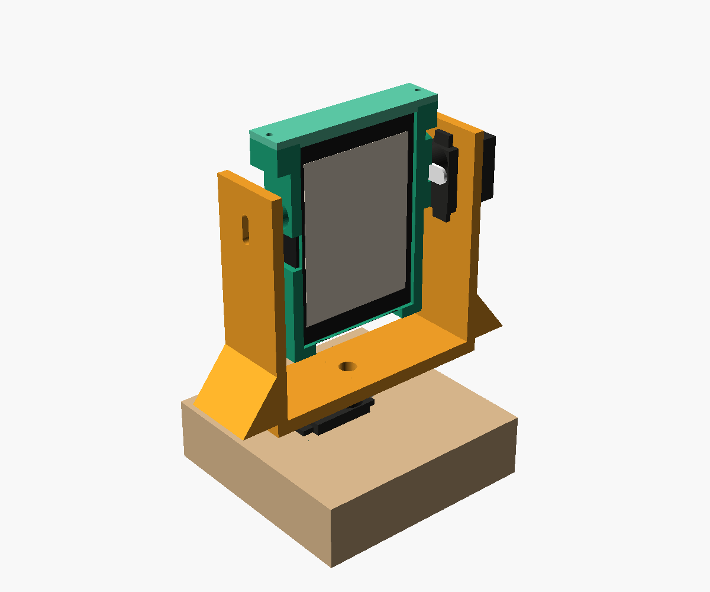

# 打印的水獭头部

两个 SC09 舵机加 ESP32-S3-Touch-LCD-2.8 板的两轴头部，分 4 个打印件。模型是 OpenSCAD 参数化文件 `otter_head.scad`：量出来的尺寸都写在文件开头，改一个数就能重新生成。

| 零件 | 作用 | 打印尺寸 |
|---|---|---|
| `base` 底座 | 1 号舵机竖着挂在顶板的方孔里，转轴朝上 | 84 × 84 × 23 mm |
| `yoke` U 形支架 | 底下接 1 号的舵盘（左右转）；右臂挂 2 号舵机，左臂用 M3 螺丝做另一端的轴 | 116 × 28 × 84 mm |
| `head` 头框 | 板子从上往下插进去；右边接 2 号的舵盘（点头），左边是 M3 螺丝的盲孔 | 66 × 76 × 14 mm |
| `clip` 顶盖 | 从上面压住板子，两颗螺丝固定 | 66 × 14 × 4 mm |

点头的轴在板子中心上方 12 mm：头的重心在轴下面，舵机放松后头会自己垂直挂着，不会栽下去。头底下留了 15 mm 给 USB-C 插头和线，用弯头（L 形）USB-C 线更从容。总高约 13.5 cm。

## 生成 STL

    cd /Users/zouguoyang/Developer/otter/hardware
    for p in base yoke head clip; do openscad -D "part=\"$p\"" -o output/cad/otter-head-$p.stl cad/otter_head.scad; done

每个零件导出时已经摆成最好打印的方向，不需要支撑。`part="layout"` 是 4 个零件摆在一起的预览。

## 打印建议

- PLA 就行。层高 0.2 mm，3 圈外壁，填充 20～30%，不加支撑。
- 没有打印机的话，可以把 4 个 STL 上传到网上打印服务（比如嘉立创 3D 打印）。螺丝要直接拧进零件，选 PLA 或尼龙，别选太脆的材料。
- 先打 `yoke` 和 `head`，装上舵机试一下，没问题再打其余的。

## 要准备的螺丝

| 东西 | 数量 | 用在哪 |
|---|---|---|
| 舵机自带的十字舵盘、舵盘小螺丝、中心螺丝 | 2 套 | 舵盘固定到支架和头框；舵盘固定到舵机转轴 |
| M2 自攻螺丝，6～8 mm | 4 颗 | 两个舵机的耳朵，每个舵机 2 颗 |
| M2 自攻螺丝，8 mm | 2 颗 | 顶盖 |
| M3 × 12 螺丝 + M3 螺母 | 各 1 | 左边的转轴；只有 M3 × 16 的话，螺丝头下垫 2～3 个垫片，免得顶进板子的位置 |

## 组装顺序

1. **先让两个舵机回中位**（`face-control.py center 1`、`center 2`），之后不要拧转轴。
2. **底座**：1 号舵机从上往下插进方孔，耳朵搭在顶板上，拧 2 颗耳朵螺丝；线从背面的缺口出去。
3. **U 形支架**：十字舵盘的长臂顺着底板放进底面的十字槽，拧 2 颗舵盘小螺丝。
4. **头框**：另一个十字舵盘的长臂竖着放进右侧圆台的十字槽，拧 2 颗舵盘小螺丝。
5. **2 号舵机**：从支架内侧把机身穿过右臂的方孔，耳朵贴在右臂内侧，拧 2 颗耳朵螺丝。
6. **装头**：头框保持屏幕竖直朝前，把头框上的舵盘按到 2 号的转轴上。从头框里面穿过中间的圆孔，拧上中心螺丝。
7. **左边的轴**：M3 螺丝从外面穿过左臂的长孔，里面拧上螺母；调到螺丝正对头框左边的小孔，插进去以后再拧紧螺母。头应该能顺滑地上下转。
8. **支架装到底座上**：支架保持正对前方，把底面的舵盘按到 1 号的转轴上，从上面的圆孔拧中心螺丝。
9. **装板子**：先接好 USB-C、喇叭和舵机控制板的线，屏幕朝前、USB-C 朝下，从头框上面插进去；盖上顶盖，拧 2 颗螺丝。
10. **标定**：`.tools/python/bin/python scripts/head-calibrate.py`，见第九课。

## 尺寸从哪来、哪些靠估计

| 参数 | 值 | 来源 |
|---|---|---|
| 舵机机身长 × 宽 | 23.2 × 12.0 | 微雪官网 |
| 耳朵总宽、耳朵孔距、耳朵下沿到底面、转轴离近端 | 32、29.5、18、5 | 实测 |
| 机身高 | 22 | 照片估计，只影响预览 |
| 耳朵下沿到舵盘顶面 | 12.5 | 由实测的 C、E 和照片推算；差一点的话头会左右偏一点，左边 M3 螺丝伸进头框的深度跟着变，用垫片调 |
| 舵盘长臂两端、最外两孔距 | 25、20 | 实测 |
| 板子 | 73.06 × 50.54，最厚 10 | 微雪官网、实测 |
| 接口位置 | 喇叭插座在左边中间，USB-C 和舵机线在底边 | 实测，已确认是从屏幕正面看；所以 2 号舵机在右边，M3 轴在左边 |

转轴离近端的距离，照片估计像 8 mm，实测是 5 mm，所以左边的 M3 孔做成了上下 7 mm 的长孔，差几毫米也能对上。

## 还没验证

这是第一版，还没有打印出来试装。最可能要调的：方孔松紧（`fit`）、舵盘槽深（`horn_t`）、耳朵下沿到舵盘顶面（`ear_to_horn_top`）。
